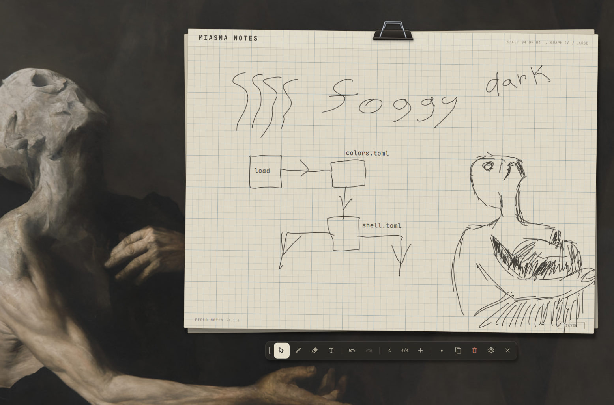

# Field Notes



A sheet of paper that floats above your Omarchy desktop. Sketch with the mouse or a pen
tablet, type notes, keep several sheets, and copy any sheet as an image with one key —
ready to paste into a chat, an issue or an AI agent.

- **Draw and write** — smooth pencil strokes (mouse wobble is steadied, tablets stay exact),
  a precise eraser, typed notes, and move-anything selection with full undo.
- **A small notebook** — up to 32 sheets, each with its own title, paper (graph, dots,
  ruled or plain) and size.
- **Share in one key** — `Ctrl+C` saves the sheet as a PNG and copies its path;
  `Ctrl+Shift+C` copies the image itself.
- **Fits your desktop** — follows your Omarchy theme live, docks its toolbar to any side,
  and stays out of the way: everything around the paper is click-through.
- **Never loses your notes** — saved automatically to a local file a moment after every change.

## Requirements

- Omarchy with the Quattro shell (`omarchy-shell`)
- `wl-clipboard` for copying, and GLib's `gio` (or `xdg-utils`) for **Open** in settings — all ship with Omarchy
- A Nerd Font for the toolbar icons — Omarchy ships JetBrainsMono Nerd Font

## Install

```sh
omarchy plugin add https://github.com/OldJobobo/field-notes.git
omarchy plugin enable jobo.field-notes
```

Omarchy adds plugins disabled so you can read the code first; enabling puts the Field Notes
icon on the right of your bar.

To open it from the keyboard, add a binding to `~/.config/hypr/bindings.lua`:

```lua
o.bind("SUPER + SHIFT + N", "Field Notes", { panel = "jobo.field-notes" })
```

To work on Field Notes from a local checkout, see [docs/DEVELOPMENT.md](docs/DEVELOPMENT.md#trying-changes-live).

## Getting started

Click the bar icon (or your keybinding) to open your notes; press it again, or `Esc`, to put
them away. Right-click the icon to open straight to settings.

The pen is ready as soon as the paper opens — just draw. Press `T` and click the paper to
type a note, `E` to erase, and `Ctrl+Z` if you change your mind. Everything you do is saved
automatically.

## The sheet

```text
         ┌──── binder clip: drag to move the board
 ┌───────┴──────────────────────────────────────────────────┐
 │ MEETING NOTES        SHEET 02 OF 03 / GRAPH 16 / MEDIUM  │ ← title · sheet · paper · size
 │                                                          │
 │                your drawings and notes                   │
 │                                                          │
 │ FIELD NOTES v0.1.5                                 SAVED │ ← version · save status
 └──────────────────────────────────────────────────────────┘
```

Everything printed in the header is also a control:

- **Title** — click it (or press `F2`) to name the sheet. `Enter` keeps the name, `Esc`
  cancels. Untitled sheets show `UNTITLED`.
- **Paper** — click to cycle **GRAPH 16 → DOTS 16 → RULED 24 → PLAIN** (or press `G`).
- **Size** — click to cycle **SMALL → MEDIUM → LARGE** (or press `S`). Your drawing keeps its
  place and size, so a sheet never shrinks below what's on it; the label tells you when no
  smaller size fits.

The status in the corner reads `SAVED` once your latest change is on disk.

## The toolbar

| Button | What it does | Key |
| --- | --- | --- |
| Grip (two lines) | Drag toward any side of the paper to dock the toolbar there | |
| Select | Pick up a stroke or note to move or delete it | `V` |
| Pen | Draw | `P` or `B` |
| Erase | Cut through strokes; removes notes it touches | `E` |
| Text | Click the paper to type a note | `T` |
| Undo / Redo | Step back and forward through your changes | `Ctrl+Z` / `Ctrl+Y` |
| ‹ 2/3 › | Previous and next sheet; on the last sheet, › becomes **+** for a new one | `PgUp` / `PgDn`, `N` |
| Width (dot) | Cycle four pen widths | `[` `]` for finer steps |
| Copy | Save the sheet as a PNG and copy its path (or the image — see Settings) | `Ctrl+C` |
| Clear | Clear the sheet — click twice to confirm; undoable | |
| Settings | Open settings | `Ctrl+,` |
| Close | Put the notes away | `Esc` |

Hover any button for its name and shortcut. Dimmed buttons have nothing to do right now.

## Drawing and writing

- **Pen** — a pressure-capable pen automatically makes lighter or firmer marks: pressure
  changes width only, from a fine line to a little beyond the width you chose. Color and
  opacity stay the same; there are
  no extra brush controls. A mouse or a pen without pressure draws at the chosen width.
  Strokes from a mouse or touchpad are steadied as you draw: pixel stair-steps and hand
  wobble are smoothed away while sharp corners and the stroke's ends stay exactly where
  you put them. Tablet input is not steadied. The mouse smoothing strength is adjustable
  in settings.
- **Eraser** — cuts strokes cleanly at the edge of the eraser ring, however fast you move,
  and removes any note it touches. One drag is one undo step.
- **Notes** — with Text, click empty paper and type. `Enter` starts a new line,
  `Ctrl+Enter` or clicking elsewhere finishes, and `Esc` cancels the edit. Click an existing
  note to edit it; an emptied note disappears.
- **Select** — click a stroke or note to select it, drag to move it, double-click a note to
  edit it, and press `Delete` or `Backspace` to remove it.
- **Undo** — `Ctrl+Z` undoes and `Ctrl+Y` (or `Ctrl+Shift+Z`) redoes, separately for each
  sheet. Undo history lasts until the shell restarts.

## Sheets

- **New sheet** — **+** at the end of the sheet buttons, or `N`. It starts with the same paper
  and size as the sheet you were on.
- **Switch** — **‹ ›** or `PgUp` / `PgDn`. A second sheet peeks out from under the page once
  you have more than one.
- **Delete** — clear a sheet and switch away: a sheet with nothing drawn, written or named
  on it is removed when you leave it. (The same rule stops blank sheets piling up.)

## Sharing a sheet

Press `Ctrl+C` (or the copy button). Field Notes saves the sheet as a PNG and puts its path
on the clipboard, ready to paste into a terminal, an editor or an AI agent:

```text
~/Pictures/field-notes/meeting-notes-20261015-091500.png
```

`Ctrl+Shift+C` copies the **image itself** instead, for pasting straight into a chat. In
settings you can swap which key does which.

The image is the sheet as it would print — straight, with its title, paper and notes, but
without the save status or any selection. Every copy is a new file named after the sheet's
title (or `sheet-02-…` if untitled), so a path you pasted earlier always shows the sheet as
it was then. Files go to `~/Pictures/field-notes/` unless you choose another folder in
settings.

## Moving things around

- **Move the board** — drag the binder clip, or use the arrow keys (hold `Shift` for bigger
  steps). `Home` centres it.
- **Dock the toolbar** — drag its grip toward any side of the paper; it snaps there as you
  drag and lies flat along the top and bottom. Or pick a side in settings.

- **More than one monitor** — the notes open on the monitor you're using: the one whose bar
  icon you click, or the focused one for your keybinding. Click the icon on another monitor's
  bar to bring open notes over. If a monitor is unplugged under them, they move to the
  focused one.

Field Notes remembers where you left the board on each monitor, and where you docked the
toolbar. On small screens the whole board scales down to fit.

## Drawing from a phone

An Android phone or tablet can draw on the open sheet, and follows it: the sheet's paper, title,
ink and typed notes appear on the device, and Undo and Redo, the eraser, new typed notes, the
title and sheet switching all act on the desktop sheet. Switch on **Draw from a phone** in
Settings; Field Notes then runs `bridge/fieldnotes-bridge`, which links the devices adb can
see and hands their strokes to the [scripting interface](#scripting). Strokes are ordinary
strokes: saved, undoable and exported like any other, and they appear on the desktop while the
pen moves.

You need Python 3 (Omarchy has it), `adb` (`sudo pacman -S android-tools`, or the Android SDK's
platform-tools) and the companion app, Field Notes for Android (in [`android/`](android/README.md)), on the device with
USB debugging on. To build, install and pair it, plug the device in and run, in `android/`:

```sh
make run
```

(That is `./gradlew installDebug` followed by `bridge/fieldnotes-bridge --pair`, which gives the app this
desktop's token and opens it; see `android/README.md` for the requirements and the first run.)

The line under the switch says what the bridge is doing:

| Status | Meaning |
| --- | --- |
| `Waiting for a phone` | running; no device is listed by `adb devices` |
| `Linked: SM-T970 (USB)` | the device is linked, over USB or Wi-Fi |
| `adb not found: install android-tools` | the bridge needs `adb`, on `PATH` or in `~/Android/Sdk` |
| `Field Notes is not responding` | the shell's scripting interface did not answer |
| `Another bridge is already running` | port 7741 is taken, for example by a bridge started by hand |

**Wi-Fi.** With Wireless debugging paired (`adb pair`), run `adb connect <ip>:<port>` once, with
the port from the device's Wireless debugging screen. The bridge remembers the address, reconnects
when the cable comes out and moves the link to Wi-Fi within a few seconds. The port changes when
Wireless debugging is switched off and on, or the device restarts; connect again then.

**What it opens.** The bridge listens on `127.0.0.1:7741` only. Devices reach it through
`adb reverse`, not over the network, and each connection must open with the pairing token kept in
`~/.local/state/fieldnotes-bridge/token`. It stops when you switch the setting off or the
shell ends. `bridge/README.md` documents the protocol.

## Settings

Open settings with the gear button, `Ctrl+,`, or by right-clicking the bar icon. Changes
apply immediately; `Esc` or clicking the dimmed paper closes them.

| Setting | Options | Default |
| --- | --- | --- |
| **Use Omarchy theme** | On: follow your Omarchy theme · Off: Field Notes' own warm graphite look | On |
| **Toolbar position** | Left · Top · Bottom · Right | Right |
| **Fade toolbar** | Fade the toolbar away while you work in another window; it comes back when you return to the notes or point at it | On |
| **Tilted paper** | A slight angle, like a sheet resting on a desk | On |
| **Mouse smoothing** | Off · Light · Medium · Strong | Medium |
| **Eraser size** | Small · Medium · Large | Medium |
| **Ctrl+C copies** | File path · Image (`Ctrl+Shift+C` does the other) | File path |
| **Export folder** | Any folder; `~` works; empty uses `~/Pictures/field-notes` | Empty |
| **Draw from a phone** | On: Field Notes runs the [phone bridge](#drawing-from-a-phone) while it is loaded · Off: nothing runs | Off |

**About** shows where your notes are saved, with buttons to **Center board** and
**Reset settings**.

## Theming

With **Use Omarchy theme** on, the toolbar, settings and tooltips take their colours from
your current Omarchy theme and change the moment you switch themes. They match the rest of
your shell: the toolbar uses the theme's popup surface, buttons use its hover, selected and
pressed states, tooltips use its tooltip colours, and corners follow your window rounding.
The paper always stays paper-coloured.

To fine-tune the toolbar for one theme — or for every theme, in
`~/.config/omarchy/shell.toml` — add a `[field-notes]` section. Colours can be hex values or
palette roles (`foreground`, `background`, `accent`, `urgent`):

```toml
[field-notes]
background = "#1e4147"
background-alpha = 0.94
border = "accent"
border-alpha = 0.6
border-width = 1
text = "foreground"
accent = "accent"
danger = "urgent"
```

Every key is optional; anything you leave out comes from the theme.

## Scripting

Scripts, demos and agents can drive Field Notes through the shell:

```sh
omarchy-shell jobo.field-notes open
omarchy-shell jobo.field-notes newSheet
omarchy-shell jobo.field-notes setPaper dots
omarchy-shell jobo.field-notes draw '60 80  200 80  200 160' 900   # x y pairs, drawn over 0.9 s
omarchy-shell jobo.field-notes copy path        # prints the PNG's path
```

| Method | What it does |
| --- | --- |
| `status` | The open sheet as JSON: number, title, paper, size, tool, save status, the last export, the monitor it is on (`screen`, with all of them in `screens`), and the sheet's `corners` on screen |
| `open` / `close` / `toggle` | Show or put away the notes (on the focused monitor) |
| `openOn <output>` | Show the notes on a monitor by name, such as `DP-1`; `status` lists them in `screens` |
| `newSheet` / `selectSheet <n>` | Add a sheet after the last, or open sheet `n` (counted from 1) |
| `setTitle <text>` / `setPaper <graph\|dots\|ruled\|plain>` / `setSize <small\|medium\|large>` | Change the open sheet |
| `setTool <select\|pen\|eraser\|text>` / `setPenWidth <1–12>` | Pick a tool and pen width |
| `ink <points>` | Show a stroke in progress, as a phone does while its pen moves: it stays until `draw` takes its place, `ink ""` removes it, or five seconds pass without news. `points` as for `draw` |
| `erase <points> <final>` | Sweep the eraser along `points` with the current eraser size; the result shows at once. `final` `1` ends the gesture as one undo step, `0` keeps it open (it closes itself after five seconds). A note being typed is committed first |
| `draw <points> <ms>` | Draw a stroke live over `ms` milliseconds, exactly as given. `points` is `"x y x y …"` in sheet coordinates (not a bracketed list, which the command line splits up); strokes queue up and draw one after another. A note being typed is committed first |
| `stopDrawing` | Drop the strokes still waiting to be drawn |
| `addNote <x> <y> <text>` | Add a typed note; `\n` starts a new line and `\\` is a backslash. A note being typed is committed first |
| `undo` / `redo` | Step through the open sheet's history |
| `clear` | Clear the open sheet, like the toolbar's Clear (undoable) |
| `center` | Centre the board |
| `copy <path\|image>` | Save the sheet as a PNG and copy its path or the image; `""` copies what `Ctrl+C` does |

Sheet coordinates run from the top-left of the paper: small sheets are 520×380, medium 760×560
and large 1040×760. While the notes are open, `status` gives the paper's corners in screen pixels, clockwise
from top-left, so a script can turn a point on screen into one on the sheet. Actions answer `ok` or
`error: …`.

## Your notes

Your sheets, settings and layout are saved to a single file on your computer — nothing is
sent anywhere:

```text
~/.local/state/field-notes/notes.json      ($XDG_STATE_HOME/field-notes/ if set)
```

- Saving happens about half a second after each change, and again when the notes close.
  Each save replaces the file in one step, so a crash can't leave it half-written.
- To back up your notes, copy that file. To start over, close Field Notes and move it aside.
- If the file is ever unreadable, Field Notes keeps a copy as `notes.json.corrupt` before
  saving a fresh one, and loads whatever it safely can.
- A notebook holds up to 250,000 pen points across all its sheets. Field Notes stops you
  drawing past that rather than save more than it can load again. A file holding more (from an
  older version, or edited by hand) is copied to `notes.json.trimmed` before anything is saved
  over it. If that copy can't be made, Field Notes leaves the file alone and shows `NOT SAVED`.

## Troubleshooting

**The bar icon or panel doesn't appear.** Check `omarchy plugin list` shows
`jobo.field-notes` as enabled, then run `omarchy plugin enable jobo.field-notes`.

**Nothing is copied.** Copying needs `wl-copy` (from `wl-clipboard`). If an image paste
does nothing, the app you're pasting into may not accept images — paste the path instead.

**The status says `NOT SAVED`.** Field Notes can't safely use its notes file. Either the file failed
the safety checks below, or Field Notes could not copy it aside (`notes.json.corrupt` or
`notes.json.trimmed`) before saving over it. Check that
`~/.local/state/field-notes/` exists and is yours, and that `notes.json` is a plain file under
16 MiB, not a link. For safety, Field Notes won't read or overwrite anything else; the shell log
(`journalctl --user -t omarchy-shell`) says which check failed.

**My tablet strokes look smoothed.** Your tablet is reporting itself as a mouse. Set
**Mouse smoothing** to **Off** in settings.

**My pen has no pressure response.** Field Notes uses the pressure your device and desktop
report to Qt. A tablet configured to emulate only a mouse cannot provide pressure to the
notes; it still draws at the chosen width. Existing strokes keep the width they were drawn
with — pressure applies to new pen strokes, not old notes or scripted drawing.

**It says "Lift to start another stroke".** One continuous stroke has reached its
8,192-sample limit. Lift and draw again; the stroke you just drew is kept.

**A sheet won't get smaller.** Something on it reaches past the smaller size. Move or erase
it first.

**It says "The notebook is full".** The notebook has reached a limit it can't save past: 250,000
pen points across all sheets, or 4,096 strokes and notes on one sheet (the eraser adds to that
count when it cuts a stroke in two). Clear something, or move to another sheet, to keep going.

**Open in settings does nothing.** Field Notes opens the folder with your default file manager
(`xdg-mime query default inode/directory`). Check that app opens folders on its own.

**A sheet disappeared.** Sheets with nothing drawn, written or named on them are removed when
you switch away. Give a sheet a title to keep it while it's empty.

## Uninstall

```sh
omarchy plugin remove jobo.field-notes
```

Your notes stay in `~/.local/state/field-notes/` and your exports in
`~/Pictures/field-notes/`; delete those folders if you don't want them.

## Development

See [docs/DEVELOPMENT.md](docs/DEVELOPMENT.md) for how Field Notes is built, the saved-file
format, and how to test and try changes.

## License

MIT — see [LICENSE](LICENSE).
